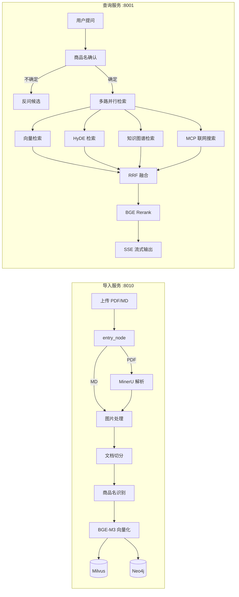

# 店典 · 多商品门店智能知识库问答系统

面向多商品门店的 RAG 问答系统。店主上传商品说明书（PDF / Markdown），系统自动解析、切分、抽取商品名并建立向量库与知识图谱，之后用自然语言提问即可得到带出处的流式回答。

和通用文档问答最大的区别：**一个门店有几十上百个商品，用户问"这个怎么拆"时必须先确定他问的是哪个商品**，否则检索会把不同商品的说明书片段混在一起。所以整个系统围绕"商品名"这个粒度做设计和约束。

---

## 架构



两条链路拆成两个独立服务：导入是重任务（PDF 解析 + 模型推理，分钟级），查询是低延迟任务（秒级），部署和扩缩容诉求完全不同。

## 核心设计

### 1. 商品名确认：置信度分层拦截

用户说"万用表怎么换电池"，但库里叫"RS-12 数字万用表"。直接拿原问题检索，向量会同时命中好几个同类商品。

流程是：LLM 从问题里抽商品名 → 拿抽出来的词去商品名向量库检索 → 按分数分层处理：

| 分数区间 | 处理方式 |
|---|---|
| ≥ 0.7 | 直接确认，进入检索 |
| 0.6 ~ 0.7 | 作为候选返回，让用户选 |
| < 0.6 | 全部不确定，反问 |

光有绝对阈值不够：如果三个商品都是 0.72 分，说明模型根本分不清，直接选第一个就是赌。所以加了**相对分差过滤**——只有和最高分差距 ≤ 0.15 的商品才进候选列表，最多 3 个。绝对阈值定下限，相对分差消歧义，两层都过不去才反问。

### 2. 混合检索：dense + sparse 双路

BGE-M3 一次编码同时产出稠密向量和稀疏向量，两路都写进 Milvus，检索时用 `hybrid_search` 一起召回。

只上稠密向量的问题：型号这种词（"RS-12"、"BT-168"）在语义空间里几乎没区分度，"RS-12" 和 "RS-13" 的余弦相似度能到 0.98，但它们是两个商品。稀疏向量按词命中，正好补这一块。

### 3. 多路召回 + 加权 RRF

四路并行召回，各自给出候选集：

- **向量检索**：主路径，dense + sparse 混合
- **HyDE**：让 LLM 先编一段"假答案"再检索，缓解问题短、口语化带来的语义偏移
- **知识图谱**：Neo4j 里存商品-部件-操作的关系，回答"XX 的配件有哪些"这类结构化问题
- **MCP 联网搜索**：库里没有的型号，兜底查外部

四路分数量纲不一致（余弦相似度、图关系置信度、网页相关度），不能直接相加。用 RRF 按排名融合：

```
score(d) = Σ weight_i / (k + rank_i(d))
```

只用排名不用分数，天然免疫量纲差异。每路可以配权重，向量和 HyDE 权重高一些。

### 4. Rerank + 断崖截断

粗排召回 20 条，BGE reranker 精排后不是简单取 top_k，而是找**得分断崖**：从最小保留数往后扫，相邻两条分差超过绝对阈值或相对比例就切断。

理由很实际——问"怎么换电池"，真正相关的可能只有 2 条，硬取 top 5 会把"怎么换保险丝"的段落塞进上下文，模型就开始胡说。断崖截断让上下文长度跟着问题走，而不是固定值。

### 5. 工程细节

- **LLM 客户端按 `(model, response_format)` 二级缓存**，避免每个节点重复建连接
- **BGE-M3 与 Reranker 全局单例**，模型只加载一次
- **任务化 + SSE**：上传和查询都先返回 `task_id`，前端轮询状态或订阅流式输出，避免长任务阻塞请求
- **敏感配置全部走环境变量**，仓库只留 `.env.example`

## 技术栈

| 层 | 选型 |
|---|---|
| 服务 | FastAPI + Uvicorn |
| 编排 | LangGraph（StateGraph，条件边 + 并行扇出） |
| 向量库 | Milvus（hybrid search：dense + sparse） |
| 知识图谱 | Neo4j |
| 文档解析 | MinerU（PDF → Markdown + 图片抽取） |
| 嵌入 / 精排 | BGE-M3 / BGE Reranker（FlagEmbedding，本地 GPU） |
| 会话存储 | MongoDB |
| 文件存储 | MinIO |
| 前端 | 原生 HTML + SSE |

## 快速开始

### 1. 依赖服务

需要自备 Milvus、Neo4j、MongoDB、MinIO 四个服务，本地 Docker 起即可：

```bash
docker run -d --name milvus -p 19530:19530 -p 9091:9091 milvusdb/milvus:latest
docker run -d --name neo4j -p 7474:7474 -p 7687:7687 -e NEO4J_AUTH=neo4j/password neo4j:latest
docker run -d --name mongo -p 27017:27017 mongo:latest
docker run -d --name minio -p 9000:9000 -p 9001:9001 minio/minio server /data --console-address ":9001"
```

PDF 解析依赖 MinerU，需要 GPU 环境（CPU 也能跑，但很慢）。

### 2. 安装

```bash
python -m venv .venv
source .venv/bin/activate        # Windows: .venv\Scripts\activate
pip install -r knowledge/requirements.txt
```

`requirements.txt` 里 torch 指向 cu128 源。如果你没有 NVIDIA 显卡，先手动装 CPU 版 torch 再装其余依赖。

### 3. 配置

```bash
cp knowledge/.env.example knowledge/.env
```

填这几项就能跑：`OPENAI_API_BASE`、`OPENAI_API_KEY`（任意 OpenAI 兼容接口，如阿里云百炼）、`NEO4J_PASSWORD`、`MINIO_ACCESS_KEY`、`MINIO_SECRET_KEY`。

BGE 模型默认从 HuggingFace 拉取，也可以把 `BGE_M3_PATH` 指向本地模型目录。

### 4. 启动

```bash
python -m knowledge.api.import_router    # 导入服务 :8010
python -m knowledge.api.query_router      # 查询服务 :8001
```

浏览器打开 `http://localhost:8010/import` 上传文档，`http://localhost:8001/chat.html` 提问。

## 接口

**导入服务**

| 方法 | 路径 | 说明 |
|---|---|---|
| POST | `/upload` | 上传文件，返回 `task_id` |
| GET | `/status/{task_id}` | 查询导入进度 |

**查询服务**

| 方法 | 路径 | 说明 |
|---|---|---|
| POST | `/query` | 提交问题，返回 `task_id` |
| GET | `/stream/{task_id}` | SSE 流式获取回答 |
| GET | `/history/{session_id}` | 拉取会话历史 |
| DELETE | `/history/{session_id}` | 清空会话 |

## 目录结构

```
knowledge/
├── api/                    # 两个服务的入口与路由
├── processor/
│   ├── import_process/     # 导入图：解析 → 切分 → 商品名 → 向量化 → 入库
│   └── query_process/      # 查询图：商品名确认 → 多路召回 → 融合 → 精排 → 输出
├── services/               # 业务编排（上传、查询、任务）
├── utils/                  # Milvus / Neo4j / MinIO / BGE / LLM / SSE 封装
├── schema/                 # 请求响应模型
├── prompts/                # 提示词
├── front/                  # 前端页面
└── requirements.txt
```
